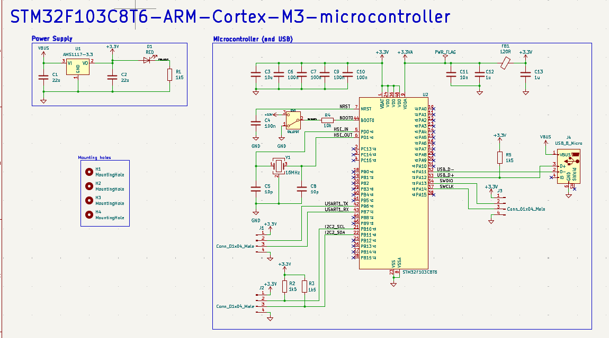
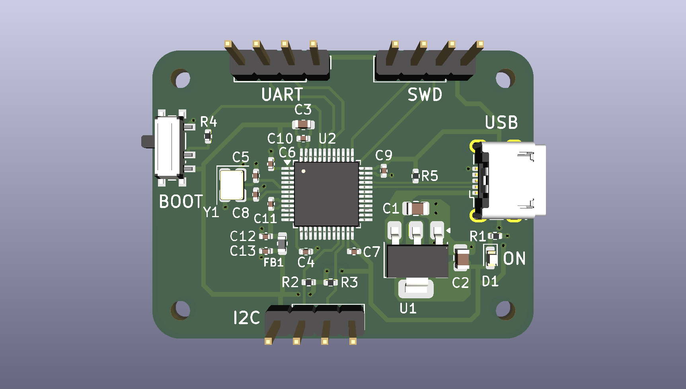

# STM32F103C8T6 "Blue Pill"

A small custom PCB built around the **STM32F103C8T6** (ARM Cortex-M3, 72 MHz) microcontroller.





## Features

- **MCU:** STM32F103C8T6 (LQFP-48, 64 KB Flash, 20 KB RAM)
- **Power:** USB 5 V input → AMS1117-3.3 LDO → 3.3 V rail, with a power LED (D1)
- **Clock:** 16 MHz crystal (Y1) with load capacitors
- **USB:** USB Micro-B connector (J4) with 1.5 kΩ pull-up on D+
- **Boot:** SPDT switch (SW1) to select boot mode via BOOT0, with a 10 kΩ resistor (R4) on BOOT0
- **Debug:** 4-pin SWD header (SWDIO, SWCLK, 3.3 V, GND)
- **Serial:** 4-pin USART1 header (TX/RX, 3.3 V, GND)
- **I2C:** 4-pin I2C2 header (SCL/SDA with 1.5 kΩ pull-ups, 3.3 V, GND)
- **Mounting:** 4 × M3 mounting holes

## Pin / Header Summary

| Header | Pins | Signals | MCU Pins |
|--------|------|---------|----------|
| J1 (UART) | 4 | 3.3 V, TX, RX, GND | USART1 TX/RX (PA9 / PA10) |
| J2 (I2C) | 4 | 3.3 V, SCL, SDA, GND | I2C2 SCL / SDA (PB10 / PB11) |
| J3 (SWD) | 4 | 3.3 V, SWDIO, SWCLK, GND | PA13 / PA14 |
| J4 | — | USB Micro-B | PA11 (D-), PA12 (D+) |
| SW1 | — | BOOT0 select | BOOT0 |

> Pin assignments are taken from the schematic net labels. Double-check against the schematic before wiring.

## Specifications

| Item | Value |
|------|-------|
| MCU | STM32F103C8T6 (LQFP-48, 7 × 7 mm) |
| Supply input | 5 V via USB |
| Regulator | AMS1117-3.3 (SOT-223) |
| Crystal | 16 MHz |
| Board title | STM32 Demo PCB, rev 0.1 (2025-08-01) |
| EDA tool | KiCad (project files `.kicad_pro` / `.kicad_sch` / `.kicad_pcb`) |

## Bill of Materials

Full list: [`manufacture/STM32-BOM.csv`](manufacture/STM32-BOM.csv)

| Ref | Qty | Value | Footprint |
|-----|-----|-------|-----------|
| C1, C2 | 2 | 22 µF | 0805 |
| C3 | 1 | 10 µF | 0603 |
| C4, C6, C7, C9, C10 | 5 | 100 nF | 0402 |
| C5, C8 | 2 | 10 pF | 0402 |
| C11 | 1 | 10 nF | 0402 |
| C12, C13 | 2 | 1 µF | 0402 |
| D1 | 1 | Red LED | 0603 |
| FB1 | 1 | 120 Ω ferrite bead | 0603 |
| J1, J2, J3 | 3 | 1×4 male pin header (2.54 mm) | — |
| J4 | 1 | USB Micro-B (Würth 629105150521) | — |
| R1, R2, R3, R5 | 4 | 1.5 kΩ | 0402 |
| R4 | 1 | 10 kΩ | 0402 |
| SW1 | 1 | SPDT slide switch | PCM12 |
| U1 | 1 | AMS1117-3.3 | SOT-223 |
| U2 | 1 | STM32F103C8T6 | LQFP-48 |
| Y1 | 1 | 16 MHz crystal | 3225 (4-pin) |

## Manufacturing Files

The [`manufacture/`](manufacture) folder contains everything needed to order the board:

- **Gerber files** (`*.gbr`): copper, solder mask, paste, silkscreen, and edge cuts
- **Drill file** (`STM32.drl`)
- **Pick-and-place** (`STM32-all-pos.csv`)
- **BOM** (`STM32-BOM.csv`)

## Project Structure

```
STM32F103C8T6/
├── STM32.kicad_pro      # KiCad project
├── STM32.kicad_sch      # Schematic
├── STM32.kicad_pcb      # PCB layout
├── 629105150521 (rev1).stp  # Würth USB Micro-B 3D model
├── images/              # Schematic and 3D render images
└── manufacture/         # Gerbers, drill, BOM, pick-and-place
```


## License

This project is licensed under the MIT License. See [LICENSE](LICENSE) for details.

The bundled Würth Elektronik 3D model is not covered by this license and remains under its owner's terms.
